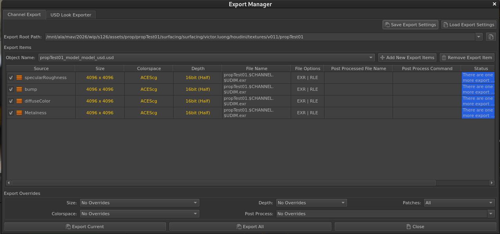
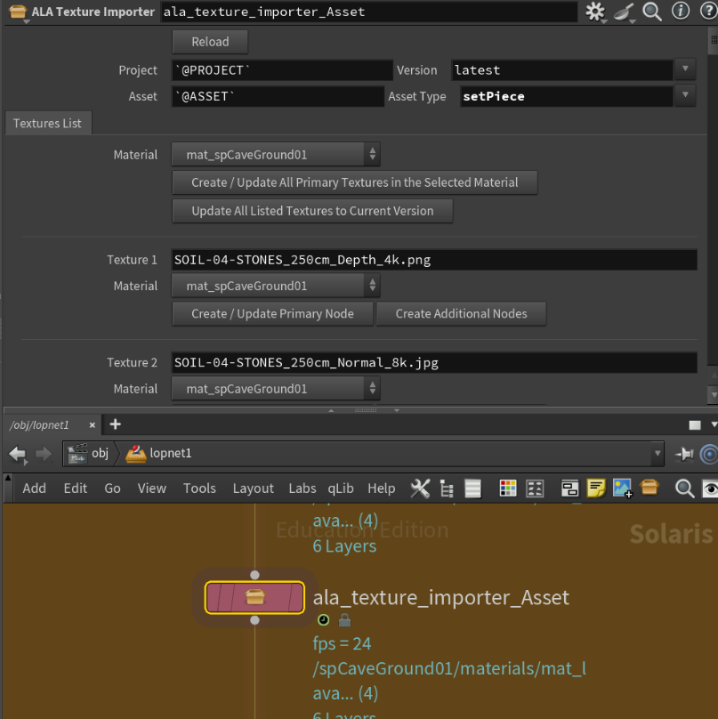
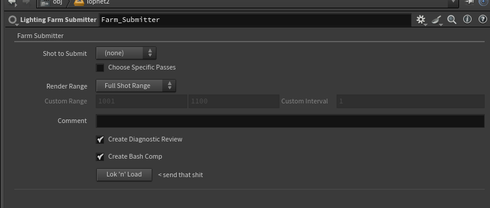
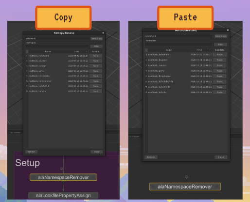

# Portfolio

## About Me

TBD

---

## ALA Pipeline

https://github.com/vicluong/portfolio/tree/main/ala_pipeline

### Notable Implementations

#### Mari to Houdini Pipeline

**Built with:** Mari, Houdini

Developed a pipeline between Mari and Houdini that streamlines the transfer of textures, automating the process of import and material setup while seamlessly integrating with the current ALA pipeline infrastructure.

  
  

---

#### Karma Lighting Submission

**Built with:** Tractor, Houdini, Nuke

Developed a pipeline between Houdini and Nuke that provides users with various render settings before automatically rendering denoised frames that then connect to Nuke review tools.

  

---

#### NetCopy

**Built with:** Maya, Houdini  
**Integrated with:** Katana, Nuke

Developed a cross-DCC tool that can quickly transfer assets, animations and nodes to other desktops that share the same disk space.

  

---

## Collaborative Projects

### Pixie Dust

**Built with:** Maya, Houdini, Katana, Nuke

Developed a full pipeline for a project that fully accommodates automated file allocation, versioning and publishing.

https://github.com/vicluong/pixie-dust

<!-- Images -->

---

### Snake Break

**Built with:** Unreal

Served as game programmer and level designer for a game created for the SXSW 2025 Game Jam. The game was shortlisted and displayed at the SXSW Sydney Games Festival.

https://itch.io/jam/snakejam/rate/3863691

<!-- Images / GIF -->

---

### Maya Material Maker

**Built with:** Maya

Developed a tool that, given a folder with various properly named texture maps, creates a material in Maya. Created for an ALA student's project.

<!-- Images -->

---

## Personal Projects

### Simple Maya Tool Suite

**Built with:** Maya

A simple suite of tools for use in Maya. Some examples include quick module reloading, mesh duplication around a point and auto fill.

https://github.com/vicluong/maya-tools

<!-- Images / GIF -->
