# ALA Pipeline

## Mari to Houdini Pipeline

Built with: Mari, Houdini

Developed a pipeline between Mari and Houdini that streamlines the transfer of textures, automating the process of import and mateiral setup while seamlessly integrating with the current ALA pipeline infrastructure.

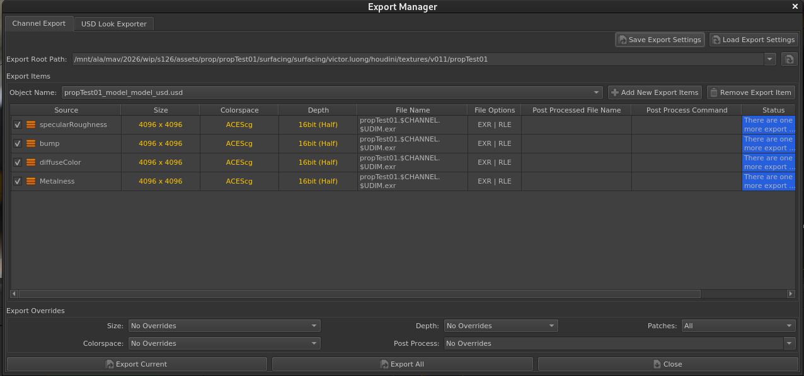

<!--
- Images
-->

## Karma Lighting Submission

Built with: Tractor, Houdini, Nuke

Developed a pipeline between Houdini and Nuke that provides users with various render settings before automatically rendering denoised frames that then connect to Nuke review tools.

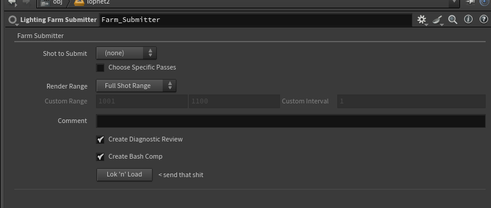

<!--
- Images
-->

## NetCopy

Built with: Maya, Houdini
Integrated with: Katana, Nuke

Developed a cross-DCC tool that can quickly transfer assets, animations and nodes to other desktops that share the same disk space.

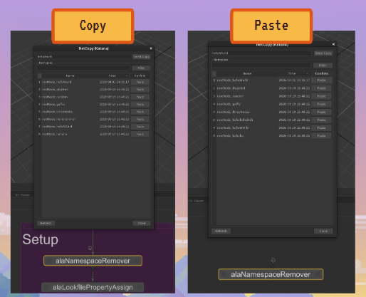

<!--
- Images (and maybe gif)
-->

## Karmaboy

Built with: Houdini

Developed an automated procedure upon publish of a USD layout / animation that fully renders the scene in Karma.

<!--
- Images
-->

## Focal Point Tracking

Built with: Maya

Developed a tool that allows for the quick manipulation of the depth of field based on the location of a focal point locator

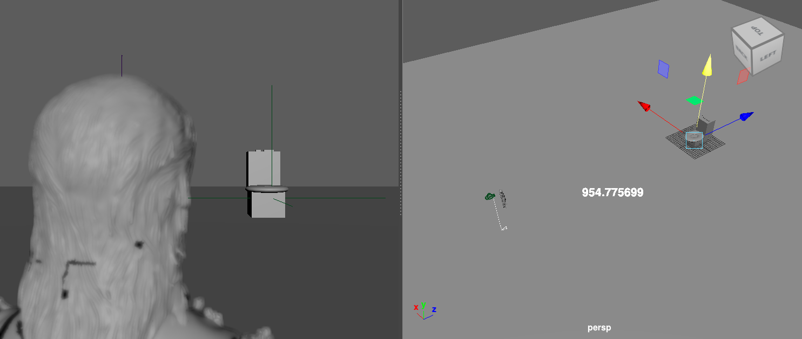

<!--
- Gif
-->

## Comp Builder - Light Groups Extension

Built with: Nuke

Extended the existing comp builder tool to support the manipulation of light groups

<!--
- Images
-->

## RV Shot Updater

Built with: RV

Developed a tool that allows artists to immediately update any shots they have to the latest version in RV

- Plans to include quick versioning up and down and quick import of sequence and shots
<!--
- Import code
- Images
  -->

## Animation USD Rollout

Built with: Maya, ShotGrid, USD

Co-developed a tool that allows for any USD rig publishes to propogate their changes to the relevant USD animations

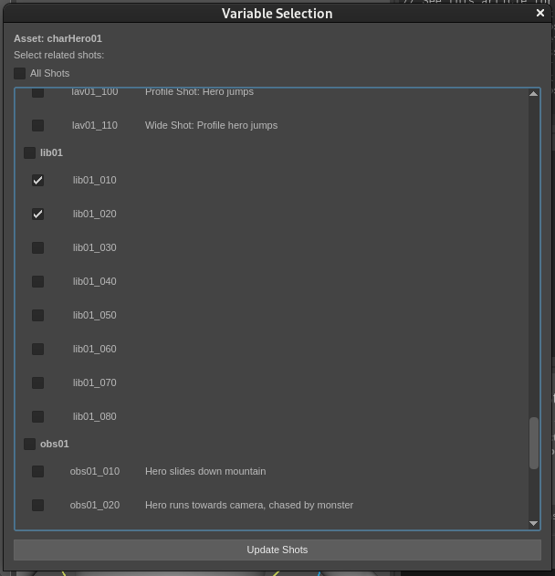

<!--
- Snippet of code
- Images
-->

## Modelling Template For QC

Built with: Houdini

Co-developed a modelling template for use in Houdini for QC

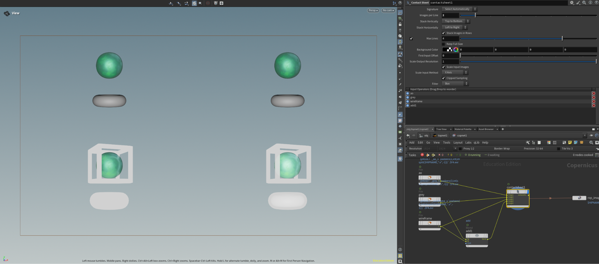

<!--
- Is there code?
- Images (or maybe gifs)
-->

## External Node Validation

Built with: Maya, ShotGrid

Implemented a validation check that ensures artists don't affect their submissions with external nodes, unless specified otherwise

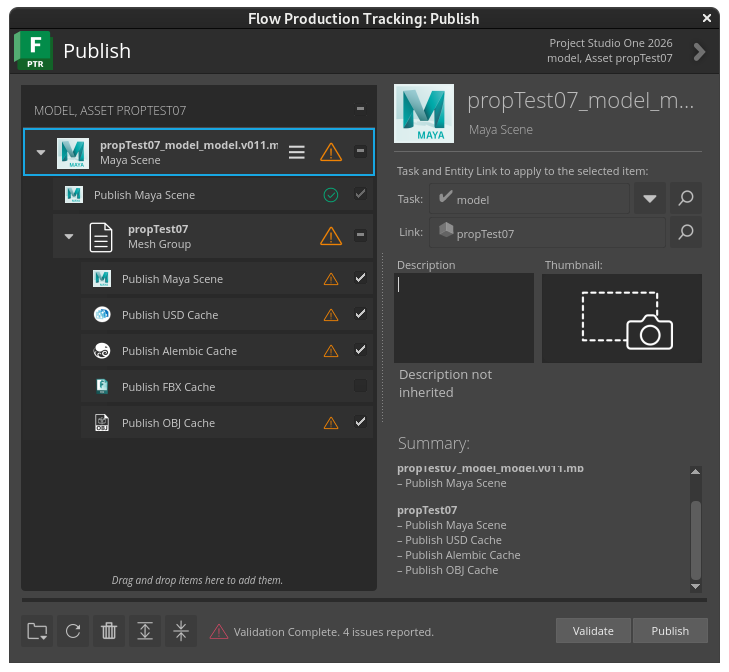
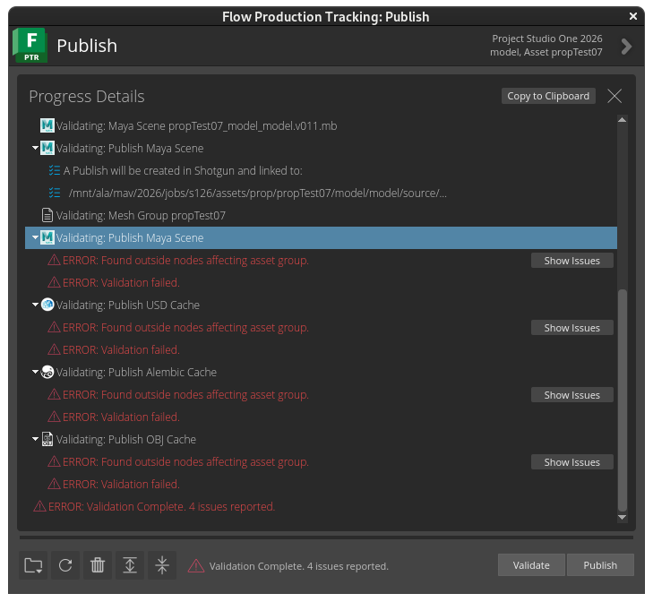

<!--
- Don't import code / snippet of code
- Images
-->

## Geometry Sequence Clips Integration

Built with: Houdini, USD

Implemented the optional use of geometry sequence clips to save disk space and reuse animation clips

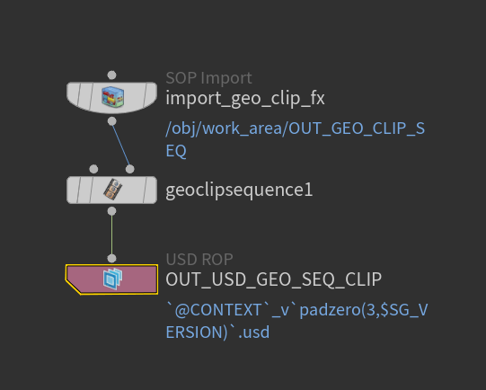
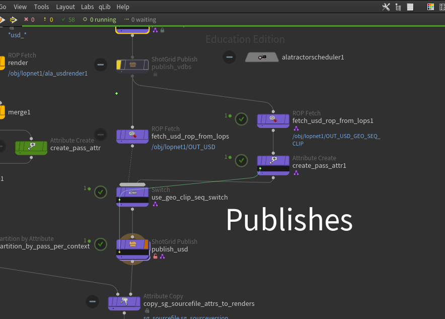
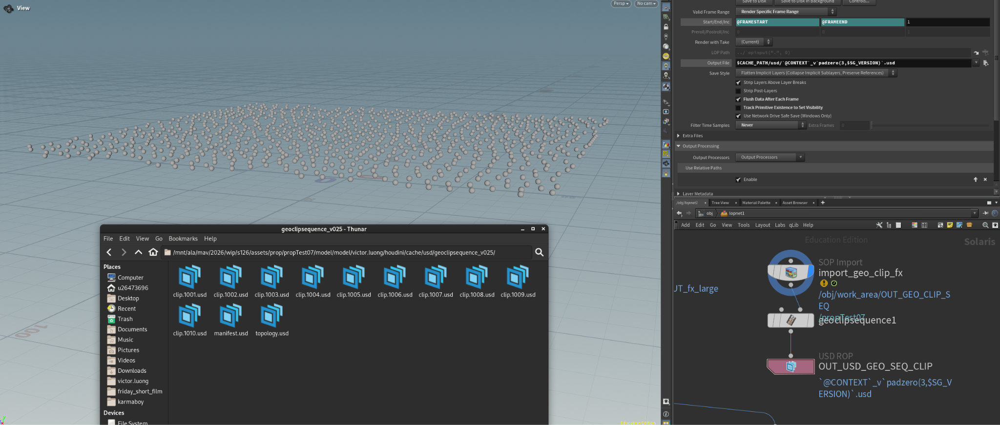

<!--
- Don't import code / snippet of code
- Images (of HDA)
-->

## Draft Deletion

Built with: Houdini, ShotGrid

Implemented the ability to tag renders in ShotGrid and then delete them later on

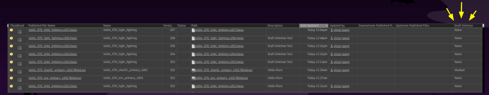

<!--
- Import code
- Images
-->
